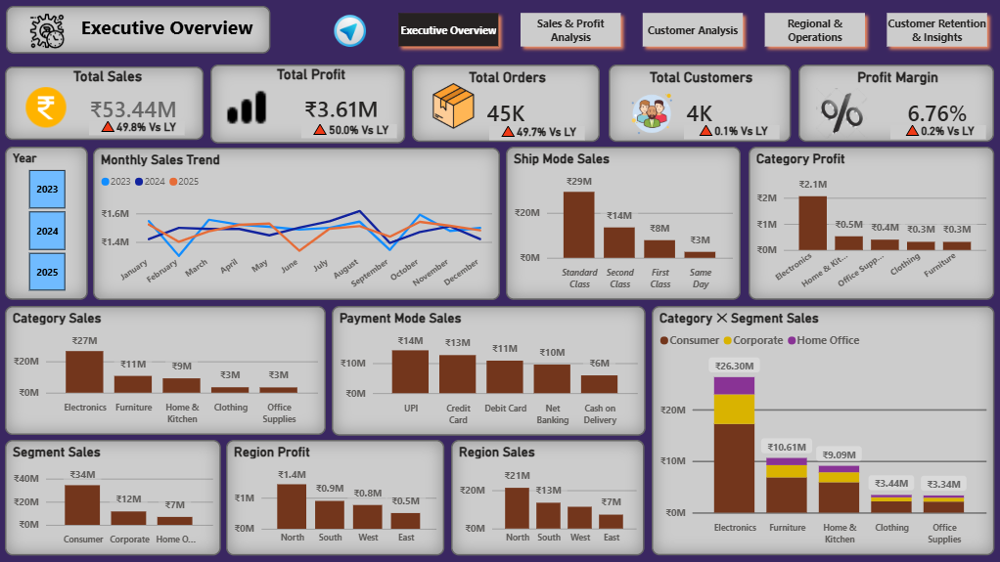
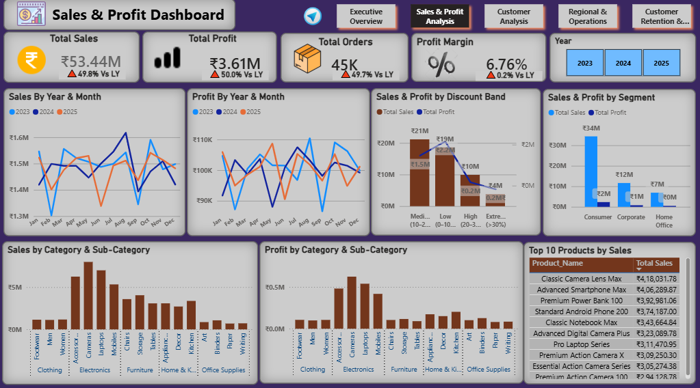
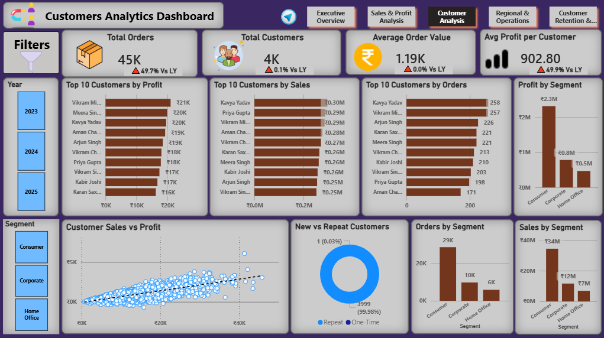
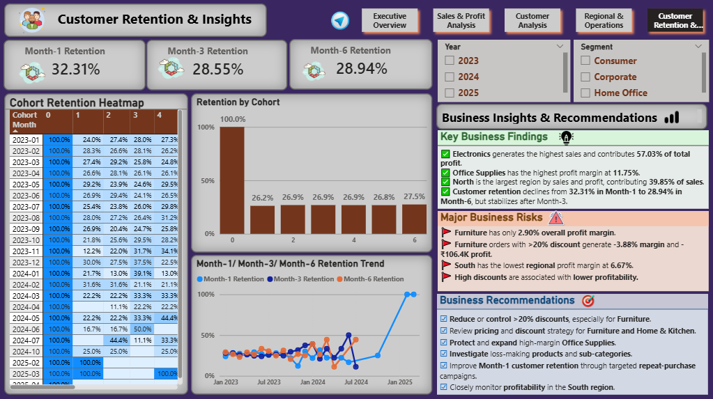
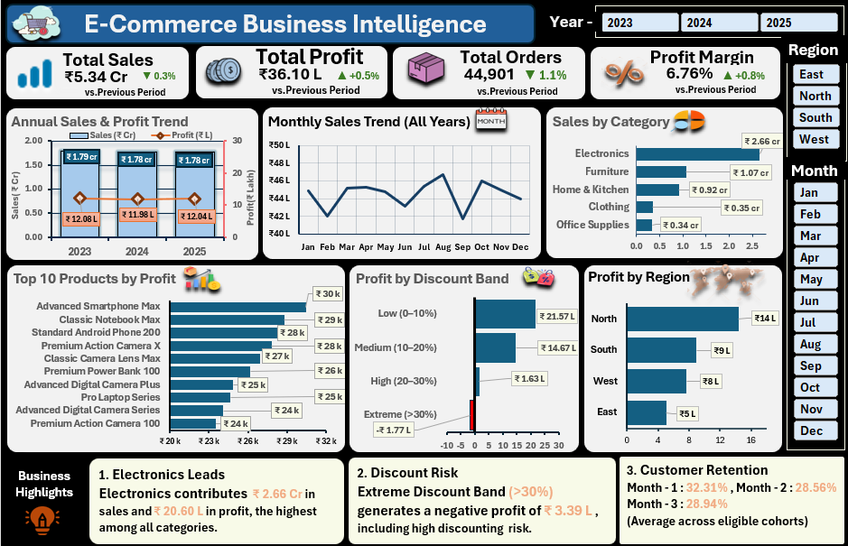

# E-Commerce End-to-End Business Intelligence & Customer Analytics

An end-to-end e-commerce analytics portfolio project using **MySQL,
Python, Microsoft Excel, and Power BI**. The project brings together
data preparation, SQL-based analysis, notebook-based exploration,
spreadsheet analysis, and interactive business dashboards to examine
sales, profitability, customers, retention, regional performance, and
operations.

## Project Overview

The project uses a multi-table e-commerce dataset containing order,
customer, and product information. The workflow is organised into
separate stages so that the data and deliverables for each tool can be
reviewed independently.

### Tools Used

-   **MySQL** --- database setup, raw-data profiling, data cleaning,
    validation, and business analysis.
-   **Python** --- analysis in a Jupyter Notebook using the project
    notebook.
-   **Microsoft Excel** --- business analysis and executive dashboard.
-   **Power BI** --- interactive dashboards for executive, sales,
    customer, regional, and retention analysis.

## Repository Structure

``` text
Ecommerce_End_to_End_Business_Intelligence/
│
├── 01_Dataset/
│   ├── 01_Raw_Data/
│   └── 02_Cleaned_Data/
│
├── 02_MySQL/
│   ├── 01_Database_Setup/
│   ├── 02_Data_Profiling/
│   ├── 03_Data_Cleaning/
│   ├── 04_Data_Validation/
│   ├── 05_Business_Analysis/
│   ├── 06_Documentation/
│   └── README.md
│
├── 03_Python/
│   └── ecommerce.ipynb
│
├── 04_Excel/
│   └── Excel_Executive_Dashboard.png
│
├── 05_PowerBI/
│   ├── 01_Executive_Overview.png
│   ├── 02_Sales_Analysis.png
│   ├── 03_Customer_Analysis.png
│   ├── 04_Regional_Operations_Dashboard.png
│   └── 05_Customer_Retention_Insights.png
│
└── 06_Documentation/
    ├── Project_Methodology.md
    ├── KPI_Definitions.md
    ├── Business_Insights.md
    └── Data_Cleaning_Report.md
```

## Analysis Areas

The project examines the following business areas:

-   Overall sales and profit performance
-   Yearly and monthly sales trends
-   Product category and sub-category performance
-   Customer sales, profit, and order behaviour
-   Customer retention and cohort analysis
-   RFM-based customer segmentation
-   Regional sales and profitability
-   Shipping and payment-mode performance
-   Discount-band profitability
-   Business findings, risks, and recommendations

## Dashboard Snapshot Results

The following figures are displayed in the supplied Power BI dashboard
screenshots. They are dashboard-reported values and have not been
independently recalculated in this README.

  KPI                   Dashboard value
  ------------------- -----------------
  Total Sales                   ₹53.44M
  Total Profit                   ₹3.61M
  Total Orders                      45K
  Total Customers                    4K
  Profit Margin                   6.76%
  Month-1 Retention              32.31%
  Month-3 Retention              28.55%
  Month-6 Retention              28.94%

## Power BI Dashboards

### Executive Overview



### Sales Analysis



### Customer Analysis



### Regional & Operations


### Customer Retention & Insights



## Excel Dashboard



## MySQL Project

The MySQL work is divided into separate SQL files for:

1.  Database and raw-table setup
2.  Raw-data exploration and profiling
3.  Data cleaning
4.  Data validation
5.  Business analysis and investigation

The source data was imported into MySQL using **MySQL Workbench Table
Data Import Wizard**. Follow the execution order described in
`02_MySQL/README.md` and the SQL project notes. The SQL scripts were run
and tested in the project environment by the author.

## Python Project

The Python work is provided as a Jupyter Notebook:

-   `03_Python/ecommerce.ipynb`

Open the notebook in Jupyter Notebook, JupyterLab, or a compatible
notebook environment. Check the dataset paths in the notebook and update
them if your local folder location differs.

## Data

The `01_Dataset` directory separates the original raw files from the
cleaned files used for analysis.

-   `01_Raw_Data` --- original source files.
-   `02_Cleaned_Data` --- cleaned versions prepared for analysis.

Dataset source, usage rights, and redistribution conditions should be
checked before publishing the data publicly. Do not upload confidential
or personally identifiable records unless you have permission to share
them.

## How to Explore the Project

1.  Review this README for the project overview and dashboard results.
2.  Open `02_MySQL/README.md` for the SQL execution sequence and
    data-import instructions.
3.  Review the SQL scripts in their numbered folders.
4.  Open `03_Python/ecommerce.ipynb` to inspect the Python notebook.
5.  View the Excel and Power BI dashboard screenshots in their
    respective folders.
6.  Read the documents in `06_Documentation` for methodology, KPI
    definitions, cleaning notes, and business insights.

## Notes and Scope

-   The Excel and Power BI folders contain dashboard screenshots for
    portfolio review; the full Excel workbook and Power BI `.pbix` file
    are not included in this repository package.
-   The Python deliverable currently included is the Jupyter Notebook.
-   The MySQL scripts and supporting notes are organised in `02_MySQL`.
-   Dashboard figures in this README are reproduced from the supplied
    screenshots; refer to the underlying project files for detailed
    calculations and query logic.

------------------------------------------------------------------------

**Project:** E-Commerce End-to-End Business Intelligence & Customer
Analytics\
**Tools:** MySQL \| Python \| Microsoft Excel \| Power BI
